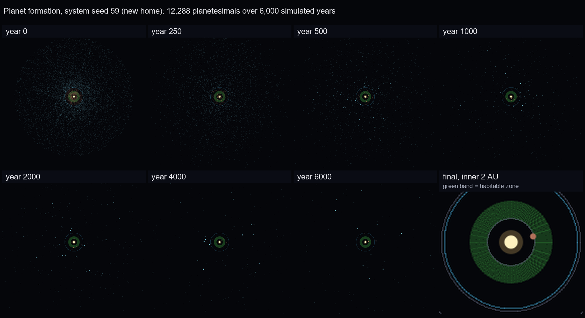
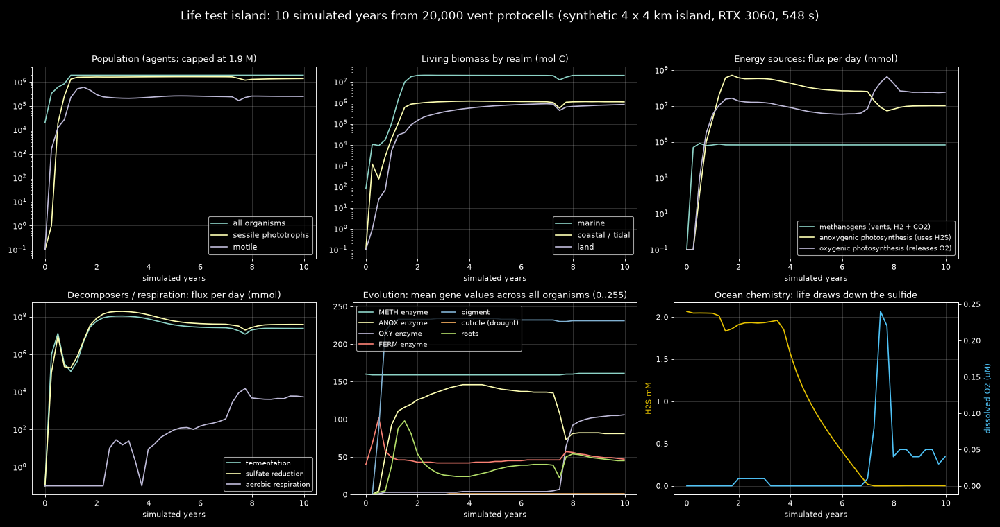
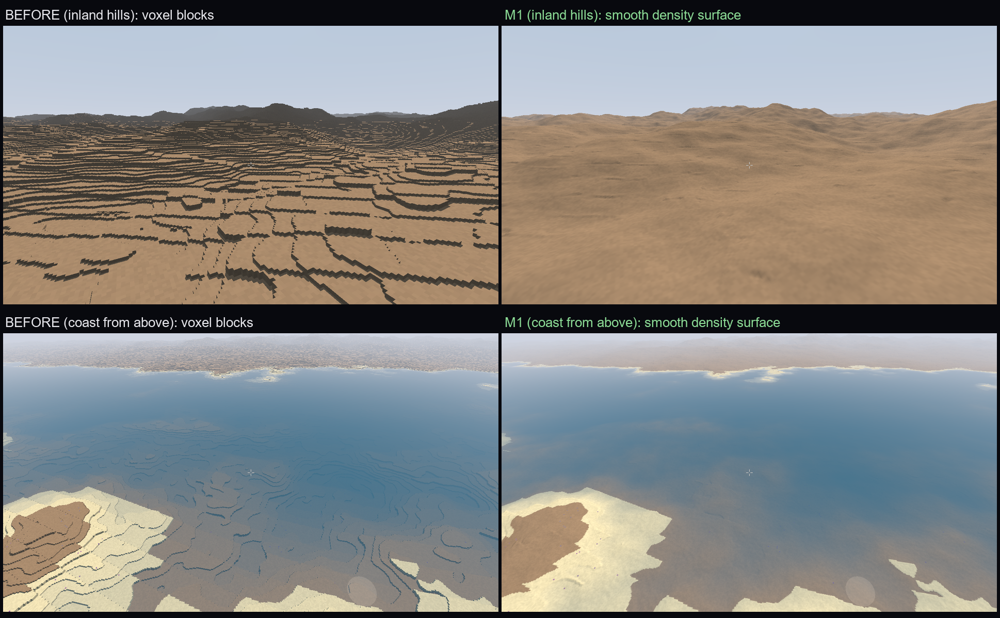
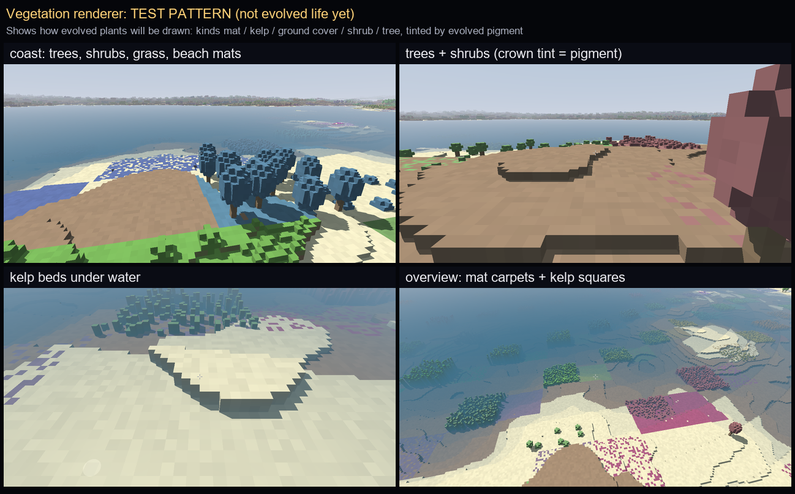
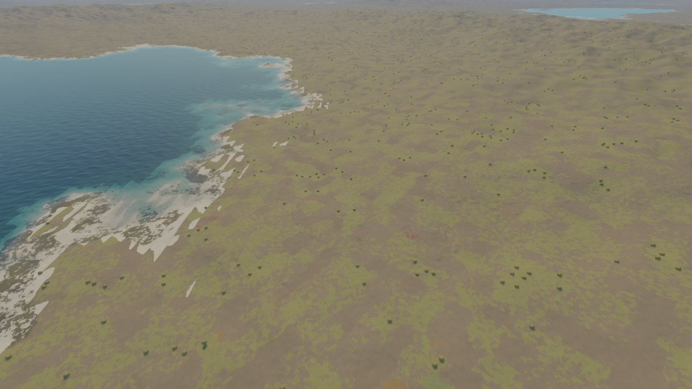
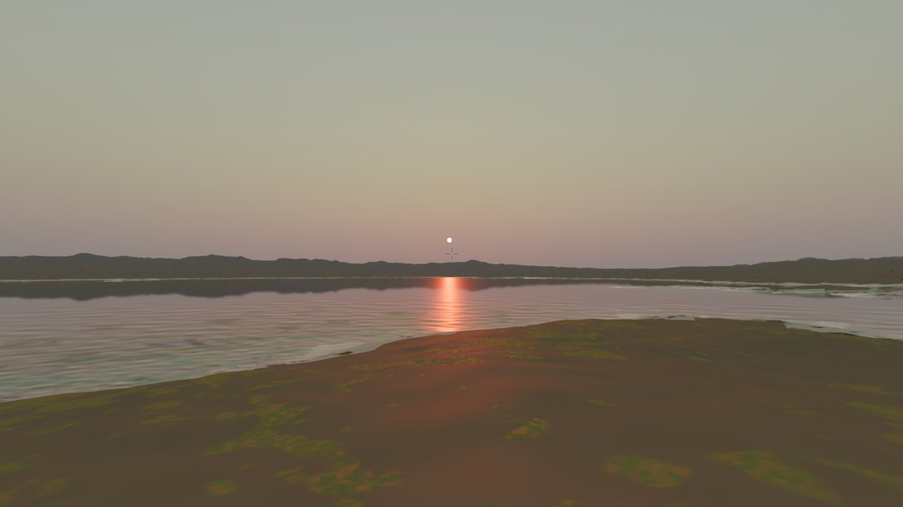

# GME: a world booted from physics

GME is an experimental game engine in **C17 + CUDA**. It builds its world from first principles and then lets life evolve in it:

1. **A star system forms.** A star and a dust disk; planetesimals collide and merge into planets through GPU N-body gravity. Rock, ice and gas are sorted by the disk's temperature.
2. **Chemistry decides the materials.** The chosen planet's crust becomes atoms with real valences (H1, O2, N3, C4, Si4, …). They form, break and swap bonds by real bond energies while the planet cools. What survives becomes the building blocks: granite or basalt, iron ore, sulfides, water, the atmosphere's gases, and organics. Carbon is the atom with the most varied bonds.
3. **Life evolves.** Self-copying organisms carry an energy budget, a genome of enzymes and body genes, and a small neural network. They evolve on islands of the real terrain, starting at hydrothermal vents. Phototrophs, oxygenic photosynthesis and land plants emerge without scripting. The simulation is integer-only, so a run is bit-identical on every GPU and on the CPU.
4. **The world is streamed and rendered on the GPU.** A sparse voxel world is sized to the machine, and a CUDA ray tracer shows it. Evolved vegetation becomes part of the voxel world.

The heavy stages run headless on a small GPU cluster over SSH. The rigs need only the NVIDIA driver: GPU code is compiled at run time with NVRTC, so no CUDA toolkit is required there.

| Planet formation (12,288 planetesimals, 6,000 years) | Life on a test island (10 simulated years) |
|---|---|
|  |  |

| Smooth density terrain (render upgrade M1, before / after) | Vegetation kinds and pigment colours (test pattern) |
|---|---|
|  |  |

| Evolved vegetation after ~3,000 simulated years (new renderer) | Sunset through the methane haze |
|---|---|
|  |  |

**Status:** research prototype, Windows-first (headless Linux build for render nodes). Star system formation, chemistry and the integer life simulation work end to end. On the current planet, life has run for 3,000+ simulated years on two cluster GPUs: oxygenic photosynthesis took over, an oxidation event followed, and 70–78% of the islands are vegetated. The renderer upgrade (smooth density surfaces, 8-band spectral light, far field to 32 km, bounced light, pigment colours; [docs/render-upgrade-spec.md](docs/render-upgrade-spec.md)) is built, reviewed and fixed; `--quality classic|low|medium|high|ref` picks the renderer (classic = the original voxel ray tracer). Animals (predation), creature rendering and a walkable player are not built yet.

## Requirements

- **Engine (`gme`):** Windows 10/11, an NVIDIA GPU (developed on an RTX 3060, sm_86), CUDA Toolkit 12+ (developed with 13.4), Visual Studio 2022 Build Tools (MSVC), CMake 3.24+ and Ninja.
- **Simulation tools (`gme_genesis`, `gme_biotest`):** plain C. They build with MSVC or gcc (Linux) and need only the NVIDIA driver plus an NVRTC library at run time.

## Build & run (Windows)

From PowerShell (the `.\` prefix is required there):

```
.\build.bat                             # all targets into .\build (or: .\build.bat <dir> <target>)
.\build\gme.exe                         # opens the 3D view (loads genesis/home.planet and life/home.biomap if present)
.\build\gme.exe --bench                 # headless: fill + 20 s flight + CPU/GPU validation
.\build\gme.exe --bench --cpu           # CPU-only generation path
```

3D view controls: hold the **right mouse button** to look around, **WASD** to move, **Space** / **C** to go up / down, **Shift** for 8× speed, **mouse wheel** to change base speed, **F** to toggle shadows, **V** to switch classic / new renderer, **K** to cycle the quality preset, **P** to save a screenshot, **Esc** to quit.

View options: `--width`, `--height`, `--scale 0.5` (render at a lower resolution), `--fps N` (0 means uncapped), `--spawn X Z [EYE]`, `--look YAW PITCH`, `--region K` (start at the coast of life island K), `--frames N --screenshot file.png` (render N frames, save, exit).

World options: `--vram 0..1` (share of free VRAM for chunks, default 0.6), `--ram 0..1` (share of free RAM for the host mirror, default 0.5), `--batch N`, `--radius N`, `--seed N`, `--planet file`, `--biomap file` / `--no-life` / `--biomap-test`.

## Genesis: booting a world from physics

`gme_genesis` builds the world in stages, and each stage writes plain files into a run folder:

1. **cosmos**: a star of 0.8–1.2 solar masses forms with a dust disk. How much rock, ice and organics condense depends on the disk temperature (frost line). The planetesimals then merge under N-body gravity on the GPU, gas drag damps their orbits, and cores above about 8 Earth masses capture hydrogen and helium to become gas giants. Output: `system.txt`, `system.png`, disk frames.
2. **chem**: the chosen planet's crust is turned into atoms with valences. Monte Carlo moves form, break and swap bonds by real bond energies while the planet cools from 2500 K to its surface temperature. The molecules that survive are the materials. Reactors are independent, so `--shard i --shards n` splits them across machines.
3. **finish**: merges the chemistry shards into `home.planet`, which holds oceans, ice, soil, relief, atmosphere (with a volcanic CO2 floor), star colour and the other planets in the sky.

```
.\build\gme_genesis.exe all --dir genesis --seed 7          # everything locally (small)
.\build\gme_genesis.exe chem --dir genesis --reactors 256   # bigger chemistry for a chosen system
.\build\gme_genesis.exe finish --dir genesis
```

The included `genesis/home.planet` is system 59: a 1.00 Earth-mass planet at 0.65 AU, 22 °C, with oceans over 10% of the surface, soil on land and an early-Earth atmosphere of methane, hydrogen sulfide and ammonia. It was the best of 517 systems searched on the cluster (`search_archive/search_ranking.txt`).

Simplifications to know about: time is compressed (bodies merge inside half their Hill radius), crust volatile loss and the greenhouse effect are tuned estimates, and ocean coverage is a fitted curve. Each of these is marked in the code.

## Life: an evolving biosphere

Life is simulated offline by `gme_genesis` on square **islands** of real terrain (16.4 km, 1024 × 1024 cells of 16 m) and frozen into `life/home.biomap`, which `gme.exe` loads (hash-checked against the planet) to grow mats, kelp, ground cover, shrubs and trees. Organisms are colonies or individuals with a genome of enzymes, body genes and a small neural network; nothing is scripted: chemistry, light, tides and selection decide what evolves. Plan and formulas: [docs/biosphere-spec.md](docs/biosphere-spec.md).

```
.\build\gme_genesis.exe env --scout                      # pick 6 islands -> life/regions.txt (+ regions.png)
.\build\gme_genesis.exe env --island 5                   # island 5's environment -> runs/bio_<planet>/island_5/env.bin, env.png
.\build\gme_genesis.exe life --island 5 --cap 1000000    # run it on GPU 0 (Ctrl+C checkpoints and stops)
.\build\gme_genesis.exe life --island 5 --resume         # continue from the newest checkpoint
.\build\gme_genesis.exe bioexport --run runs\bio_<planet>\island_5 --out life\islands\5\biopart_5.bin
.\build\gme_genesis.exe bioexport --merge life\islands --out life\home.biomap
.\build\gme_genesis.exe life-test                        # test suite (--cpu for the CPU reference)
```

`life` options: `--device D` or `--cpu`, `--cap N` agents (0 = from free memory), `--duty 0..1` (share of GPU time), `--years Y` / `--days D` (0 = forever), `--minutes M` (wall-clock limit), `--checkpoint-min M` (default 30; the last 3 checkpoints are kept), `--salt S`, `--seed-protocells N` (default 20000), `--maps-every Y`, `--metrics-every D`. It exits 3 when life goes extinct. One step is one hour, one sim-year is 8760 steps.

A run folder holds `env.bin`, `ckpt_*.bin`, `metrics.csv` (daily: population, carbon by realm, pathway fluxes, atmosphere, conservation residuals, mean genes), `census.csv` (yearly carbon by guild and realm), `stages.log` (gates G0–G5, interventions) and `maps/` (yearly PNGs). `biostat --run DIR` summarises the newest checkpoint.

Compressions to know about: the island atmosphere is a box of 1e-4 of the real air column, tides are ±1 m, one agent is a clonal colony (super-individual) of up to 1e9 mmol C, and the population is held at 0.95 of `--cap` by a fair birth lottery. Each island has its own land-barrier multiplier (×0.7 … ×1.3) as a parameter study.

## Running on a GPU cluster

The scripts in `cluster/` drive Linux rigs over SSH (key login) and tmux. Configure your machines first:

```
copy cluster\hosts.example.ps1 cluster\hosts.local.ps1   # then edit: SSH user, rig A, rig B (git-ignored)
```

On each rig: the NVIDIA driver, gcc, cmake, tmux, and an NVRTC library (for example `pip install nvidia-cuda-nvrtc` in a venv under `~/venvs`, or set `GME_NVRTC_DIR`).

```
pwsh cluster/launch.ps1 -Deploy         # star-system search on every rig GPU (endless; several processes per GPU)
pwsh cluster/status.ps1 [-Fetch]        # habitability ranking; -Fetch copies the best system to ./genesis
pwsh cluster/bio_launch.ps1 -Deploy     # life islands: copy + build in ~/gme/build-bio, check env CRCs, start tmux bio-isl<k>
pwsh cluster/bio_status.ps1 [-Fetch]    # per island progress; -Fetch exports and merges into life/home.biomap
pwsh cluster/timeline.ps1               # every 30 min: fetch, screenshots of every island, charts; stops when "playable"
pwsh cluster/render_remote.ps1 -Run "--frames 600 --screenshot {out}/view.png --perf" -Out status/render/x
                                        # render tests on rig B: headless Linux build of gme, coolest free GPU
```

Render tests run headless on a Linux rig: `gme` builds there without a display (`src/window_headless.c`, frames go to PNG). The CUDA compiler comes from NVIDIA's pip wheels in user space (`pip install --target ~/gme/toolchain "nvidia-cuda-nvcc==13.2.*" "nvidia-nvvm==13.2.*" "nvidia-cuda-crt==13.2.*" "nvidia-cuda-runtime==13.2.*" "nvidia-cuda-cccl==13.2.*"`, plus a `libcudart.so` symlink in its `lib`). Pin every wheel to the same version, or `ptxas` rejects the front end's PTX. The wrapper allows at most two jobs at a time and waits while a GPU is above 78 °C, because that rig's three GPUs sit close together.

## Layout

| File | Role |
|---|---|
| `src/platform.*`, `src/jobs.*` | Hardware detection, timers, large allocations; a worker pool that uses every hardware thread |
| `src/worldgen.h` | Space layout (1 voxel = 1 m, 32³ chunks) and the fixed-point terrain generator shared by C and CUDA (bit-identical CPU/GPU) |
| `src/gpu.*`, `src/world.*` | CUDA chunk pool and batched generation; residency, streaming, eviction, adaptive view radius, validation |
| `src/render.*`, `src/window_win32.c` | CUDA ray tracer and the native window |
| `src/density.h`, `src/trace.cuh` | Render upgrade (in progress): smooth density surface and its column tracer |
| `src/flora.h`, `src/biomap.*` | Vegetation voxels from the frozen biomap, the `GMEBMAP1` file |
| `src/planetfile.*` | `home.planet` load/save and the planet hash |
| `src/rtcuda.*` | Run-time CUDA: driver API + NVRTC loaded dynamically (no toolkit needed) |
| `src/genesis/` | `gme_genesis`: cosmos (N-body), chem (bond Monte Carlo), planet derivation |
| `src/bio/` | Life simulation: `bio_api.h` (contract), `bio_core.h` + `bio_kernels.cu` (integer math, NVRTC kernels), `bio_sim.c` / `bio_cpu.c` (GPU driver / CPU reference), `bio_io.c`, `bio_env.c`, `bio_main.c`, `bio_test.c` |
| `cluster/` | Cluster scripts (search, life islands, timeline) |
| `docs/` | Design specs: biosphere and render upgrade |

## Space model

- A position is a chunk coordinate (int32) plus a float offset inside the chunk, so precision is the same everywhere. The horizontal range is ±33,000 km. The vertical range is 16 layers (512 m) by default and can go up to 32.
- A chunk that is all one material (air, solid stone or open water) takes 24 bytes and no voxel storage.
- Each non-uniform chunk uses one 32 KB slot, with the same index in VRAM and in the host mirror (for CPU-side physics and gameplay queries).
- The view radius grows until the storage budget is full and shrinks if storage runs out.

## License

MIT, see [LICENSE](LICENSE).
